# Скриншоты из симулятора

Обновляются автоматически при каждой сборке. Папка = ветка.

## claude-project-thread-6jefsu

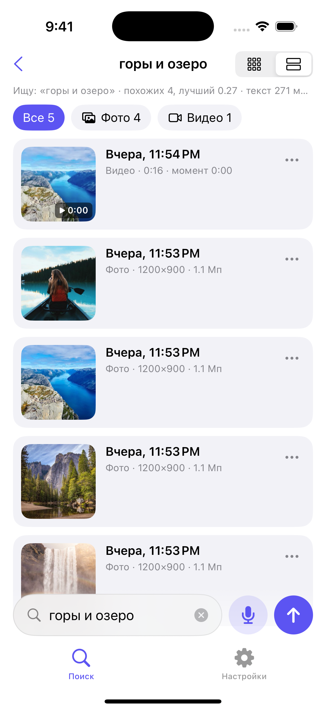

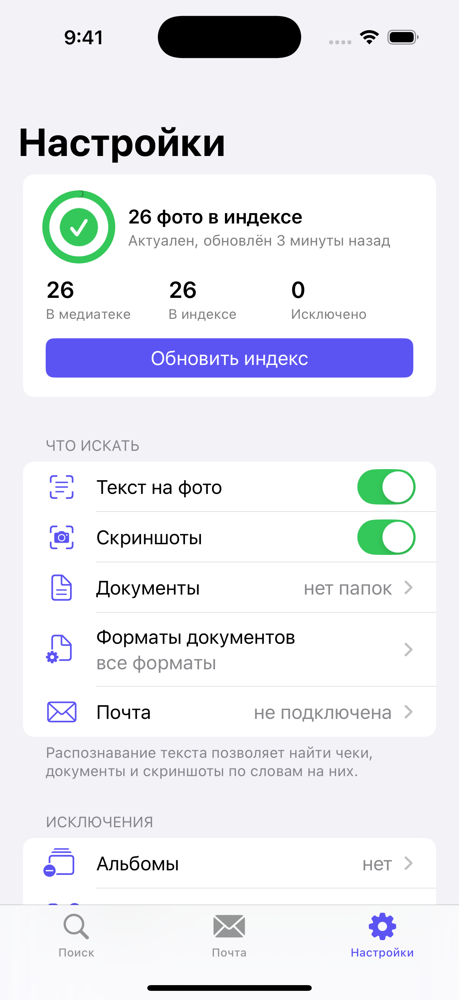
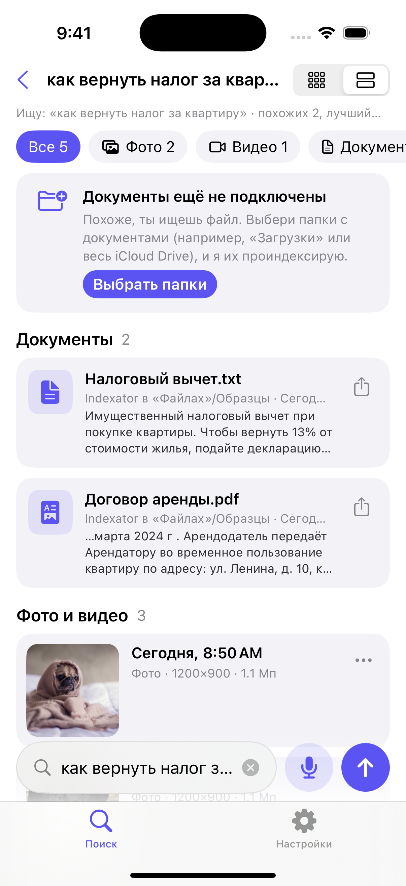
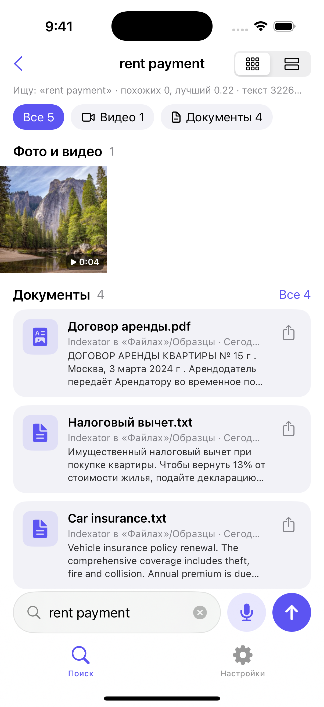

## claude-project-thread-sp7d9g

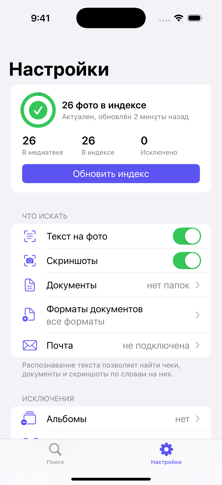
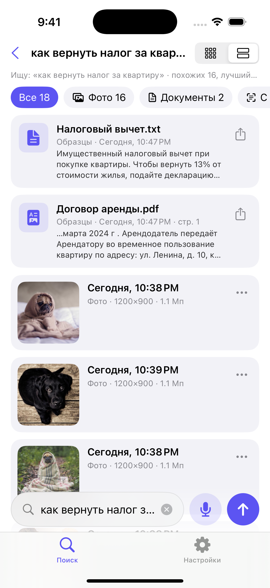
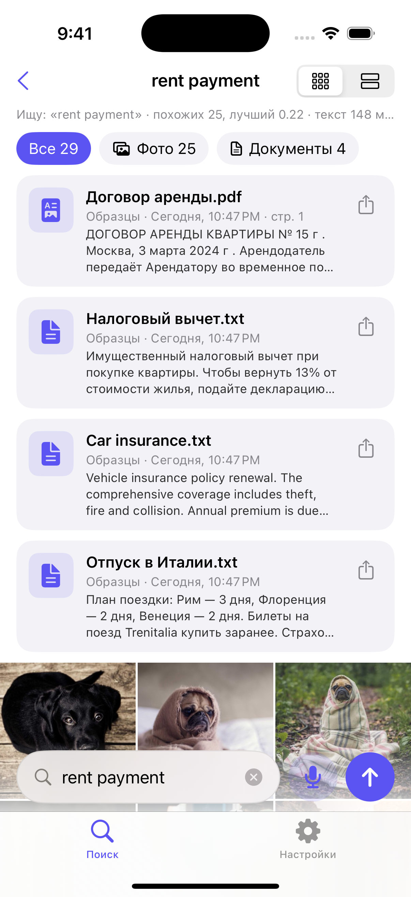

## claude-project-thread-zrkhr8

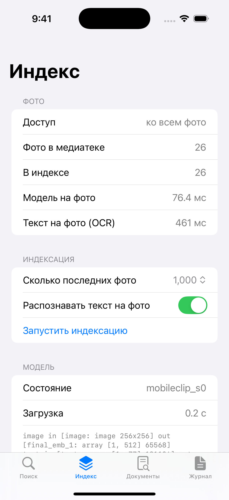
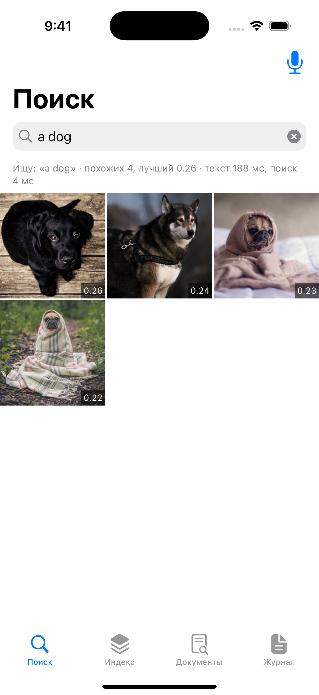
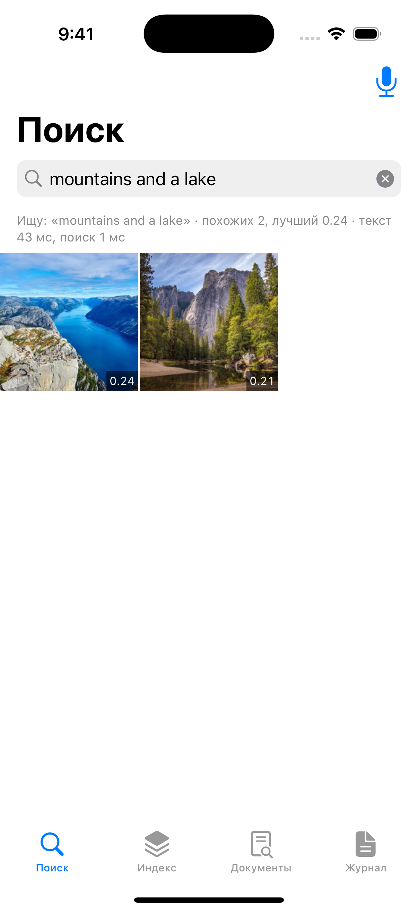

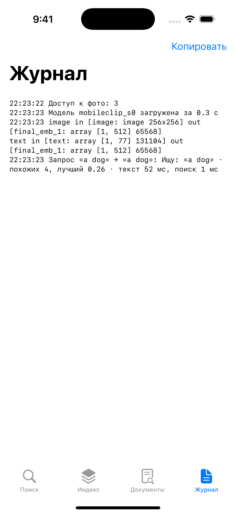
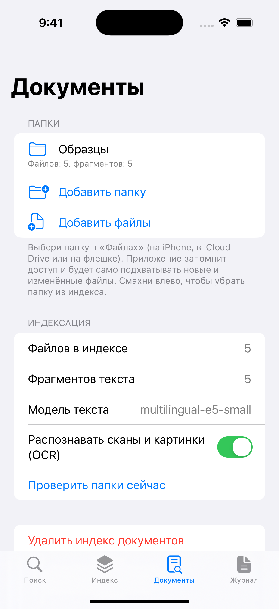
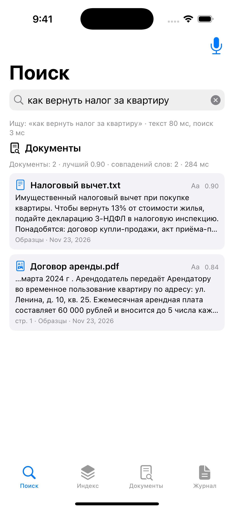
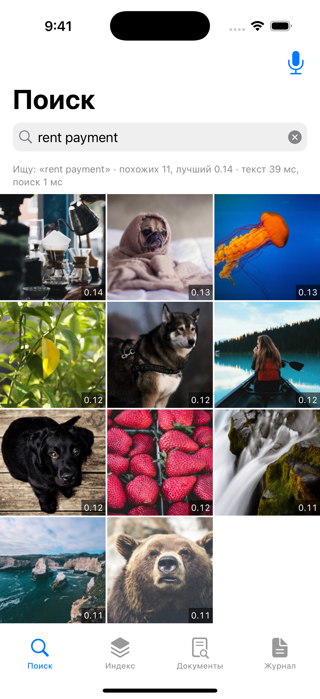
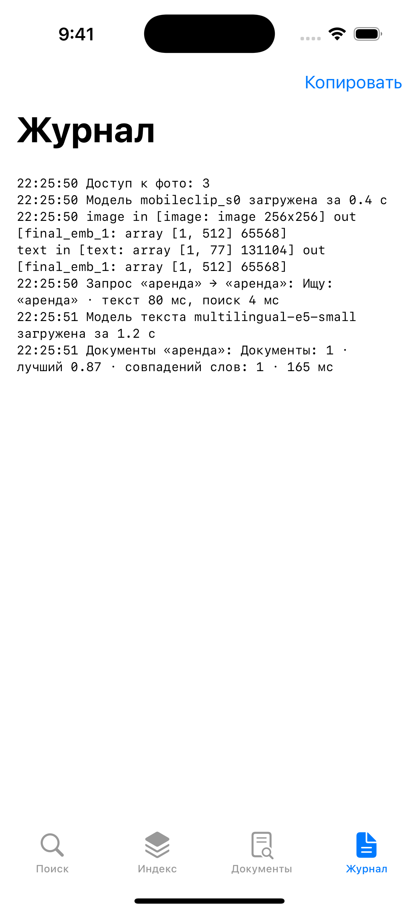

## integration

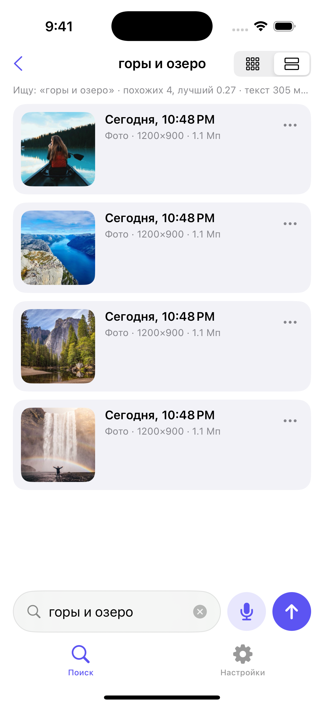

## phase1-photo-search

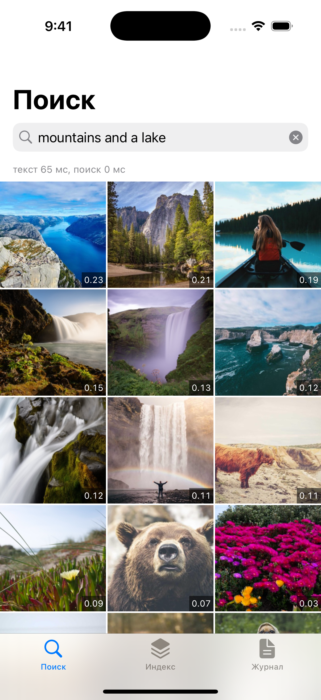
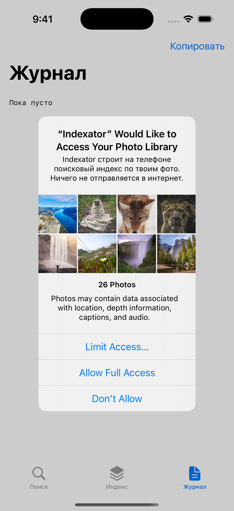

## phase2-hybrid-search

## phase3-multilingual

